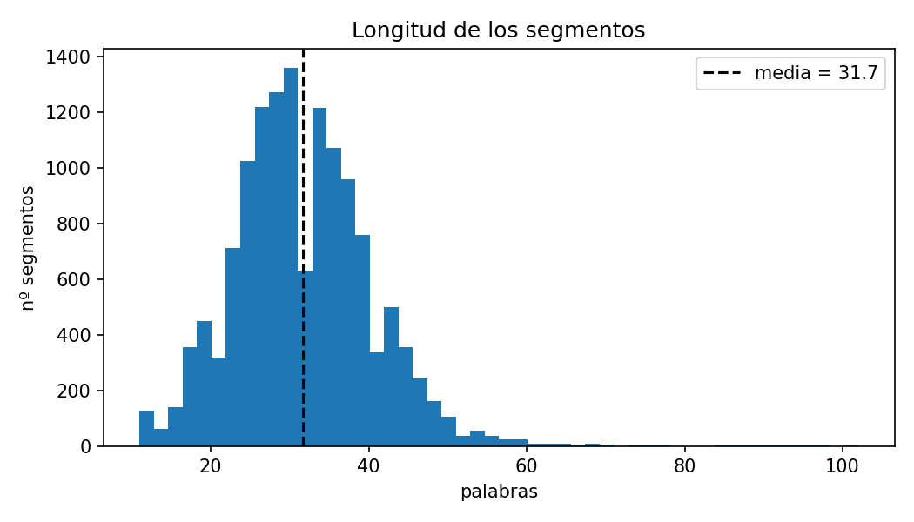
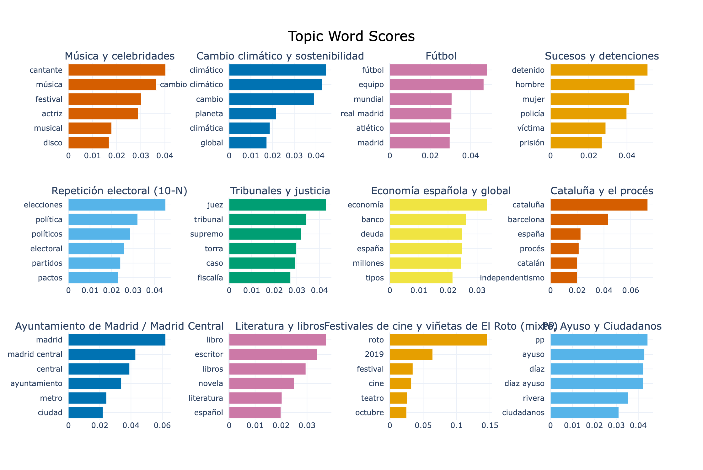
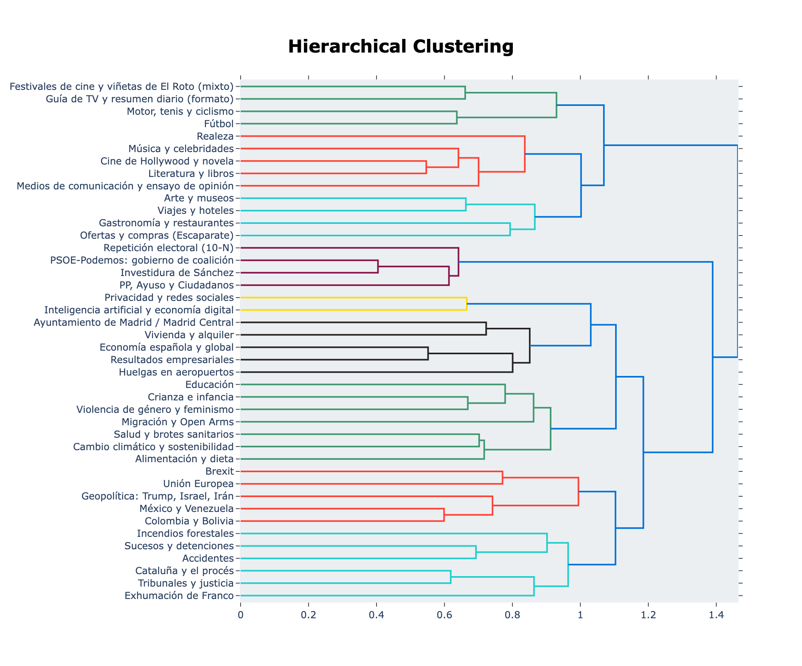

# BERTopic

## 1. Introducción y corpus
Se aplica BERTopic para encontrar los tópicos de un corpus de noticias en español.
- **Fuente:** MLSUM-es (Scialom et al., 2020), split `test`: artículos de *El País* (junio–octubre 2019), descargados de Hugging Face.
- **Idioma:** español.
- **Tamaño:** 13 920 artículos.

## 2. Segmentación
**Criterio:** 1 documento = título + resumen de un artículo. 

La unidad de análisis debe ser autocontenida y, a la vez, caber en la ventana de contexto del codificador. El cuerpo de los artículos mide ~784 palabras y no tiene saltos de párrafo en el dataset, lo que impide segmentarlo por párrafo; además, excede el límite de 128 tokens del modelo. El título y el resumen, en cambio, son una síntesis editorial del artículo.

**Limpieza:** se eliminaron 305 artículos en inglés (sección *elpais inenglish*) y 2 duplicados que crearían falsas regiones de alta densidad en el clustering.

| Estadística | Valor |
|---|---|
| Segmentos | 13 613 |
| Longitud promedio | 31.7 palabras (46.7 tokens) |
| Segmentos truncados (> 128 tokens) | 0.11 % |

## 3. Metodología
- **Embeddings:** `paraphrase-multilingual-mpnet-base-v2` (Reimers & Gurevych, 2020). Es un transformer que convierte cada texto en un vector de 768 dimensiones, de forma que textos con significado parecido quedan cerca entre sí. Se entrenó por **destilación de conocimiento**: un modelo "estudiante" multilingüe aprende, con pérdida MSE, a imitar los vectores de un modelo "maestro" en inglés. Así, el español queda representado en el mismo espacio semántico. Se eligió porque es multilingüe, es el recomendado por BERTopic para idiomas distintos del inglés y su límite de 128 tokens cubre nuestros segmentos.

- **UMAP:** `n_neighbors=15, n_components=5, min_dist=0.0, metric="cosine", random_state=14`. Agrupar directamente en 768 dimensiones funciona mal, porque en espacios tan grandes todas las distancias se parecen. UMAP reduce los vectores a 5 dimensiones conservando qué documentos son vecinos entre sí. Se usa la distancia coseno, que es la adecuada para embeddings; `min_dist=0` deja los grupos compactos, lo que facilita el clustering; y `random_state` hace que los resultados sean reproducibles.

- **HDBSCAN:** algoritmo de clustering por densidad: forma un tópico donde hay muchos documentos cercanos entre sí. A diferencia de k-means, no hay que decirle cuántos tópicos buscar, y no obliga a meter cada documento en un grupo: los que no encajan en ninguno quedan como outliers. `min_cluster_size` define el tamaño mínimo de un tópico.

- **CountVectorizer y c-TF-IDF:** para describir cada tópico, BERTopic busca las palabras más características de sus documentos frente al resto del corpus (c-TF-IDF). Se usaron stopwords en español (NLTK más palabras frecuentes en noticias como *tras, según, año*) para que palabras vacías como *de, la, que* no dominen las descripciones, y `min_df=5` para ignorar palabras demasiado raras.

**Configuraciones comparadas:**

| Config | `min_cluster_size` | Selección | `ngram_range` | `nr_topics` | MMR | Tópicos | % outliers | Tópico más grande |
|---|---|---|---|---|---|---|---|---|
| A | 30 | `eom` | (1,1) | None | No | 77 | 36.6 | 852 |
| B | 80 | `leaf` | (1,2) | None | Sí (0.3) | 42 | 40.9 | 586 |
| C | 50 | `leaf` | (1,2) | None | Sí (0.3) | 62 | 45.6 | 375 |

`ngram_range` define si las palabras clave son solo palabras sueltas `(1,1)` o también pares de palabras `(1,2)`, como *cambio climático*; afecta la descripción de los tópicos, no la agrupación. `nr_topics` fusiona los tópicos más parecidos hasta llegar a un número dado; se dejó en `None` porque el número de tópicos se controló con `min_cluster_size`.

La comparación muestra un compromiso entre **detalle e interpretabilidad**. A genera muchos tópicos muy específicos y, a la vez, un tópico enorme (852 documentos) que mezcla toda la política nacional (PSOE, PP, Podemos). B produce tópicos más amplios y fáciles de interpretar: la selección `leaf` reparte mejor los tamaños (el tópico más grande baja de 852 a 586 documentos), los bigramas captan expresiones como *cambio climático* o *madrid central*, y MMR evita palabras clave repetitivas. C, que solo baja `min_cluster_size` a 50, queda en un punto intermedio (62 tópicos), pero deja más outliers (45.6 %) y vuelve a dividir algunos temas en tópicos más pequeños. **Se eligió B.**

## 4. Resultados

### 4.1 Outliers
B deja **40.9 %** de outliers. Esto es normal en un clustering por densidad: columnas de opinión, piezas únicas o temas con pocos artículos no forman grupos. Para recuperarlos sin forzar asignaciones, se usó `reduce_outliers(strategy="embeddings", threshold=0.5)`: cada outlier se asigna al tópico más parecido (similitud coseno) solo si la similitud es al menos 0.5; los ambiguos siguen como −1. Resultado: **11.6 %** de outliers.

### 4.2 Tabla de tópicos

| Topic | Nombre | Docs | Palabras clave |
|---|---|---|---|
| -1 | Outliers | 1582 | china, hong kong, kong, hong, millones, 000, vida, euros |
| 0 | Música y celebridades | 741 | cantante, música, festival, actriz, musical, disco, vida, concierto |
| 1 | Cambio climático y sostenibilidad | 537 | climático, cambio climático, cambio, planeta, climática, global, sostenible, clima |
| 2 | Fútbol | 474 | fútbol, equipo, mundial, real madrid, atlético, madrid, partido, real |
| 3 | Sucesos y detenciones | 442 | detenido, hombre, mujer, policía, víctima, prisión, joven, detenidos |
| 4 | Repetición electoral (10-N) | 586 | elecciones, política, políticos, electoral, partidos, pactos, democracia, debate |
| 5 | Tribunales y justicia | 494 | juez, tribunal, supremo, torra, caso, fiscalía, sentencia, juicio |
| 6 | Economía española y global | 454 | economía, banco, deuda, españa, millones, tipos, crecimiento, empleo |
| 7 | Guía de TV y resumen diario (formato) | 313 | ver, 2019, actualidad, historias, jornada, noticias, clave, selección |
| 8 | Ofertas y compras (Escaparate) | 245 | mejores, ofertas, amazon, precios, productos, 15, selección, modelos |
| 9 | Cataluña y el procés | 394 | cataluña, barcelona, españa, procés, catalán, independentismo, catalana, sentencia |
| 10 | Geopolítica: Trump, Israel, Irán | 264 | trump, uu, ee uu, ee, israel, irán, presidente, donald |
| 11 | Violencia de género y feminismo | 306 | mujeres, violencia, género, sexual, mujer, orgullo, machista, igualdad |
| 12 | Ayuntamiento de Madrid / Madrid Central | 384 | madrid, madrid central, central, ayuntamiento, metro, ciudad, alcalde, capital |
| 13 | Realeza | 226 | príncipe, princesa, reina, boda, hijo, inglaterra, isabel, isabel ii |
| 14 | Cine de Hollywood y novela | 332 | película, cine, novela, serie, hollywood, actor, literatura, películas |
| 15 | Salud y brotes sanitarios | 213 | brote, enfermedad, sanidad, cáncer, enfermedades, pacientes, salud, andalucía |
| 16 | Viajes y hoteles | 303 | ciudad, ruta, verano, hoteles, fotos, hotel, barrio, viaje |
| 17 | Educación | 201 | educación, alumnos, escuela, escolar, colegio, estudiantes, universidad, universidades |
| 18 | México y Venezuela | 253 | méxico, maduro, venezuela, obrador, lópez obrador, país, lópez, ee uu |
| 19 | Migración y Open Arms | 208 | migrantes, arms, open arms, open, inmigrantes, refugiados, barco, menores |
| 20 | Brexit | 156 | brexit, johnson, boris, reino unido, unido, reino, boris johnson, británico |
| 21 | Motor, tenis y ciclismo | 184 | nadal, márquez, carrera, mundial, gana, marc, final, horarios |
| 22 | Unión Europea | 204 | ue, europa, europea, macron, unión, europeo, unión europea, alemania |
| 23 | Exhumación de Franco | 216 | franco, exhumación, exhumación franco, dictador, caídos, valle, valle caídos, restos |
| 24 | Literatura y libros | 397 | libro, escritor, libros, novela, literatura, español, juan, muere |
| 25 | Arte y museos | 283 | arte, museo, exposición, artista, obra, contemporáneo, prado, obras |
| 26 | Gastronomía y restaurantes | 163 | restaurantes, chef, restaurante, cocina, madrid, recetas, vino, receta |
| 27 | Medios de comunicación y ensayo de opinión | 300 | medios, historia, veces, tiempo, gente, verdad, mundo, vida |
| 28 | Colombia y Bolivia | 241 | colombia, paz, bolivia, morales, presidente, país, duque, gobierno |
| 29 | Accidentes | 130 | accidente, muere, vídeo, coche, heridos, muertos, avión, tráfico |
| 30 | Festivales de cine y viñetas de El Roto (mixto) | 422 | roto, 2019, festival, cine, teatro, octubre, junio 2019, octubre 2019 |
| 31 | Crianza e infancia | 172 | niños, hijos, padres, mujeres, tener, embarazo, desarrollo, niñas |
| 32 | Incendios forestales | 134 | incendio, fuego, incendios, amazonia, canaria, gran canaria, hectáreas, gran |
| 33 | Alimentación y dieta | 136 | comer, carne, alimentos, comida, productos, dieta, alimentación, salud |
| 34 | Vivienda y alquiler | 140 | vivienda, viviendas, alquiler, pisos, precio, piso, casas, precios |
| 35 | PSOE-Podemos: gobierno de coalición | 297 | psoe, podemos, socialistas, gobierno, unidas podemos, pp, coalición, unidas |
| 36 | Investidura de Sánchez | 246 | sánchez, iglesias, investidura, pedro sánchez, pedro, podemos, presidente, psoe |
| 37 | Resultados empresariales | 162 | millones, compañía, ventas, españa, grupo, euros, beneficio, coches |
| 38 | Privacidad y redes sociales | 110 | datos, facebook, privacidad, usuarios, whatsapp, información, redes, aplicación |
| 39 | PP, Ayuso y Ciudadanos | 347 | pp, ayuso, díaz, díaz ayuso, rivera, ciudadanos, vox, cs |
| 40 | Inteligencia artificial y economía digital | 131 | digital, inteligencia artificial, google, artificial, inteligencia, tasa, tecnología, internet |
| 41 | Huelgas en aeropuertos | 90 | huelga, pasajeros, aeropuerto, aerolínea, vuelos, volar, prat, cook |

### 4.3 Segmentos representativos

Se muestran 2 segmentos para 10 tópicos representativos; la lista completa (2 por cada uno de los 42 tópicos) está en el notebook y en `segmentos_representativos.csv`.

| Topic | Nombre | Segmento |
|---|---|---|
| 1 | Cambio climático y sostenibilidad | Cambio climático: No es suficiente. Los Gobiernos deben asumir mayores compromisos ante el cambio climático |
| 1 | Cambio climático y sostenibilidad | cambio climático: El reto político del cambio climático. Exijamos a nuestros líderes que lean a nuestros científicos y que actúen en consecuencia. No tenemos un planeta B |
| 2 | Fútbol | La nueva fábrica de jugadoras. Cómo el fútbol español copa el Mundial de Francia. Una de cada 10 futbolistas del torneo compitieron la última temporada en España. El FC Barcelona, con 15, es el club c… |
| 2 | Fútbol | Mundial de Fútbol Femenino 2019: resultados de los partidos. Estados Unidos gana la octava edición de la Copa Mundial Femenina de fútbol en Francia. Así ha sido el resto de partidos |
| 4 | Repetición electoral (10-N) | 10-N: ¿Fin de la política?. No son los políticos en tanto que personas, es la política en tanto que poder la que está cada vez más limitada y desorientada |
| 4 | Repetición electoral (10-N) | Elecciones generales: En el tablero no hay sitio para el acuerdo. La repetición de las elecciones generales puede explicarse por una combinación de factores sistémicos con la debilidad organizativa e … |
| 5 | Tribunales y justicia | El Tribunal Supremo descarta el delito de rebelión consumada. La condena por este delito habría implicado de 15 a 25 años de cárcel. Las penas para los líderes del 'procés' serán escalonadas según la … |
| 5 | Tribunales y justicia | El juez acuerda enviar a juicio a Torra por no retirar los lazos amarillos. La Fiscalía pide para el presidente una condena de un año y ocho meses de inhabilitación |
| 6 | Economía española y global | El Banco de España calcula que se perderán 95 millones por los aranceles de EE UU. El supervisor advierte de que los aumentos de barreras arancelarias tienen un impacto adverso y persistente sobre la … |
| 6 | Economía española y global | Funcas rebaja al 1,9% su previsión de crecimiento del PIB para 2019 y apunta a un “final de ciclo, no a una recesión”. La economía española crecerá en 2020 un 1,5%, cinco décimas menos de lo anteriorm… |
| 9 | Cataluña y el procés | Cataluña: Para un mapa sin territorio. No hay interlocutor político en Cataluña fiable y serio, y lo más importante: que sea representativo de la sociedad catalana en su conjunto. En la fórmula clásic… |
| 9 | Cataluña y el procés | Una jornada de tregua en Cataluña. Las voces agoreras que alertaban de un día de elecciones caliente en Cataluña quedaron en nada |
| 19 | Migración y Open Arms | Open Arms: La prioridad. Los náufragos del ‘Open Arms’ tienen que ser desembarcados cuanto antes |
| 19 | Migración y Open Arms | Los 15 migrantes del ‘Open Arms’ irán al centro de inmigrantes (CETI) de Chiclana de la Frontera. Los rescatados, 14 hombres y una mujer, llegarán este viernes en el buque ‘Audaz’ |
| 20 | Brexit | Las ocho fracturas del Brexit. Queda menos para la salida o queda menos para Boris Johnson, porque el Brexit nos entierra a todos |
| 20 | Brexit | Brexit: Johnson derrotado. El Parlamento británico desbarata los planes de un Brexit duro |
| 23 | Exhumación de Franco | Exhumación Franco: Parte del pasado. La derrota de la dictadura fue la Constitución, no la exhumación de Franco |
| 23 | Exhumación de Franco | Exhumación de Franco: Fin de la anomalía. El Supremo abre el camino para exhumar los restos de Franco del Valle de los Caídos |
| 35 | PSOE-Podemos: gobierno de coalición | Iglesias pide “una oportunidad” a los “socialistas de corazón”. Unidas Podemos apela a los simpatizantes del PSOE que "no han perdido la esperanza de un Gobierno conjunto" |
| 35 | PSOE-Podemos: gobierno de coalición | Sánchez e Iglesias alcanzan un acuerdo para formar un Gobierno de coalición. El PSOE y Unidas Podemos buscan pactos con otros partidos para alcanzar la mayoría. El líder de la formación morada será vi… |

### 4.4 Visualizaciones

**Barchart:** muestra las palabras más características (c-TF-IDF) de cada tópico. Los tópicos principales tienen vocabularios claros y distintos entre sí (*fútbol/equipo/mundial*, *juez/tribunal/supremo*, *cambio climático/planeta*), lo que indica que están bien separados.

**Jerarquía:** agrupa los tópicos según su parecido. Se forman macrotemas lógicos: política española, internacional, sucesos y justicia, sociedad, cultura, estilo de vida y deportes. Los dos tópicos de formato se unen a la rama de deportes, porque las guías de TV anuncian partidos televisados: se parecen por su estructura, no por su tema. Además, *PSOE-Podemos: gobierno de coalición* e *Investidura de Sánchez* se fusionan a muy poca distancia (0.41), señal de que son casi el mismo tópico.

## 5. Discusión y conclusiones
**Tópicos con sentido:** la mayoría, sobre todo los que corresponden a eventos de la agenda informativa de 2019: exhumación de Franco, Open Arms, Madrid Central, repetición electoral del 10-N, Brexit e incendios. Que un método no supervisado los encuentre muestra que los embeddings capturan bien el significado de las noticias en español.

**Tópicos sin sentido o débiles:**
- **Tópicos de formato:** la *Guía de TV* y el *resumen diario de noticias* (tópico 7) se agrupan porque siguen la misma plantilla, no porque traten el mismo tema. Los embeddings detectan esa similitud superficial y forman un grupo.
- **Tópico 30 (mixto):** junta festivales de cine y teatro con las viñetas diarias de El Roto; sus palabras clave incluyen fechas (*junio 2019, octubre 2019*), lo que delata la plantilla de las viñetas.
- **Tópico 27** (medios/opinión): palabras clave genéricas (*medios, historia, tiempo, gente*); agrupa columnas parecidas en estilo, no en contenido.
- **Mezclas y solapamientos:** el tópico 0 junta música con actrices y celebridades; los tópicos 35 y 36 tratan el mismo asunto (el pacto PSOE-Podemos) desde dos ángulos.
- **Temas pequeños perdidos:** las protestas de Hong Kong (58 artículos) no llegan a `min_cluster_size=80` y no forman tópico propio; *hong kong* aparece entre las palabras principales de los outliers. Este parámetro determina el tema más pequeño que el modelo puede detectar.

**Conclusión:** BERTopic recupera bien los temas principales del corpus, pero el resultado depende de decisiones de diseño: cómo se segmenta el texto, el tamaño mínimo de clúster y el método de selección de HDBSCAN.

## 6. Bibliografía
- Grootendorst, M. (2022). *BERTopic: Neural topic modeling with a class-based TF-IDF procedure*. arXiv:2203.05794.
- Scialom, T. et al. (2020). *MLSUM: The Multilingual Summarization Corpus*. EMNLP.
- Reimers, N., & Gurevych, I. (2020). *Making Monolingual Sentence Embeddings Multilingual using Knowledge Distillation*. EMNLP.
- McInnes, L., Healy, J., & Melville, J. (2018). *UMAP*. arXiv:1802.03426.
- Campello, R., Moulavi, D., & Sander, J. (2013). *Density-Based Clustering Based on Hierarchical Density Estimates*. PAKDD.

## 7. Declaración de uso de IA
Se usó **Claude Code** (Anthropic, Claude Opus 5.5) como apoyo para escribir el código y el borrador de este reporte. El modelo se encargó de asignar las labels a los tópicos resultantes, mientras que las decisiones como el dataset o metodología fueron planificadas con ayuda de este modelo pero siempre con decisión final mía. 

## 8. Código
[https://github.com/BaltazarSR/BERTopic](https://github.com/BaltazarSR/BERTopic)
